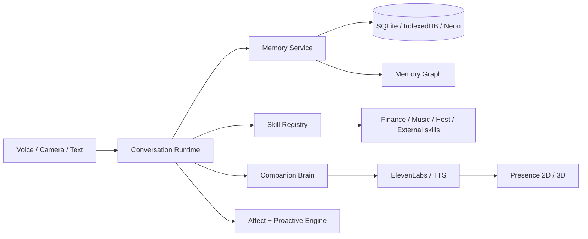

# Mira — Local-first AI Companion

<p align="center"><strong>Voice-first · Emotion-aware · Long-term memory · Desktop local · Skills · Vision</strong></p>

<p align="center">
  
  
</p>

Mira là AI companion ưu tiên **giọng nói + continuity**: trò chuyện, ghi nhớ có kiểm soát, nhận biết tín hiệu cảm xúc, thực thi skill và chạy dưới dạng Web/PWA hoặc Desktop Windows/macOS. Mira là sản phẩm độc lập (không còn kế hoạch nhúng vào Soi).

## Mira Live — hội thoại thời gian thực

Nút **LIVE** mở một cuộc gọi song công với mô hình speech-to-speech (Gemini Live API): anh nói, Mira trả lời bằng giọng ngay, nói chen thì Mira dừng. Âm thanh trả về đi qua `AnalyserNode` và điều khiển khẩu hình của lớp hiện diện (2D photoreal, và avatar 3D khi manifest được duyệt). Server phát token tạm thời dùng 1 lần qua `POST /api/chat?route=live-token`; API key không bao giờ xuống trình duyệt.

```env
GEMINI_API_KEY=        # bắt buộc cho Live
MIRA_LIVE_MODEL=       # mặc định gemini-3.8-live
MIRA_LIVE_VOICE=       # tuỳ chọn, tên prebuilt voice
MIRA_LIVE_DISABLED=    # =1 để tắt
```

Kế hoạch triển khai (định dạng ECC planner): [`docs/plans/2026-10-23-live-3d-companion.md`](docs/plans/2026-10-23-live-3d-companion.md). Bản đồ code Graphify: [`graphify-out/GRAPH_REPORT.md`](graphify-out/GRAPH_REPORT.md) — cập nhật bằng `graphify update .`.


## Kiến trúc



## Desktop Local

- Tauri 2 + Vite frontend đóng gói local; production build tự loại source/reference media không dùng khỏi `dist`.
- SQLite `mira.db`: turns, episodes, structured memory, graph, affect, permissions, music history.
- Permission được kiểm tra lại ở Rust/native layer.
- Local Music Library chỉ scan thư mục người dùng chủ động chọn.
- Lệnh mẫu: _“Mở bài …”_, _“Bật lại bài hôm trước”_, _“Bật bài anh hay nghe lúc mệt”_.
- Affect từ camera chỉ là observation có confidence, không phải sự thật về cảm xúc.

> Release hiện chưa có production code-signing/notarization đầy đủ.

## Memory

`fact` · `preference` · `life_event` · `relationship_context` · `emotional_episode` · `active_thread`

Memory Graph dùng `co_occurs` + `semantic_temporal`. Durable personal memory chỉ lấy từ điều người dùng từng tự nói. Lệnh **“đừng nhớ / đừng lưu”** chặn persistence của turn và distillation tương ứng.

## Smart Query Router

Các skill có thể khai báo `pre-brain`: tool chạy **trước** Brain, kết quả được đưa vào context dạng evidence. Finance là domain đầu tiên dùng cơ chế này:

`knowledge → Brain` · `calculation → deterministic calculator` · `live data → verified source` · `personal advice → risk policy`

## Vision & Affect

Pipeline có face landmarks, gaze/head pose, hand/pose, FACS-like activity, micro-expression và affect fusion. Nhãn cảm xúc là **ước lượng có confidence**, không phải đọc suy nghĩ hay chẩn đoán.

## Chạy local

Yêu cầu **Node.js 24 LTS**.

```bash
nvm use
npm ci
npm run dev
```

Kiểm tra đầy đủ:

```bash
npm run check
```

CI dùng **Node 24.x** làm baseline/LTS và **Node 26.x** làm forward-compatibility lane.

## Build Desktop

```bash
npx tauri build
```

- Windows x64 → NSIS installer.
- macOS Intel → DMG.

Xem [`docs/MIRA-DESKTOP-DMG.md`](docs/MIRA-DESKTOP-DMG.md).

## Brain & Voice

Production Brain Gateway hỗ trợ **Vercel AI Gateway (OIDC per-request)**, Gemini, OpenAI và Anthropic qua server-side env. ElevenLabs là voice/TTS riêng; API key không nằm trong production browser. Health chỉ kiểm tra cấu hình, **không chứng minh inference**. Để smoke test một lần bằng dữ liệu tổng hợp: `node scripts/production-brain-smoke.mjs --allow-paid-call` (có thể phát sinh phí), hoặc chạy workflow manual tương ứng.

```env
MIRA_BRAIN_PROVIDER=auto
GEMINI_API_KEY=
OPENAI_API_KEY=
ANTHROPIC_API_KEY=
ELEVENLABS_API_KEY=
```

## Licensing and media provenance

The repository's Apache-2.0 `LICENSE` is not a blanket grant for third-party 3D assets, VRoid presets, portraits or other media. A 135-file media integrity inventory and 115-package dependency-license inventory are tracked in CI. **Not all media rights have been cleared**, so an unconditional copyright-safe claim cannot be made. See [Asset Licensing](ASSET-LICENSING.md) and the [IP audit](docs/MIRA-IP-RIGHTS-AUDIT-2026-10-16.md). Standard production builds exclude unapproved lab-only 3D assets and concept references; some WebP scenes still need rights evidence.

## Docs

- [`docs/FEATURE-MATRIX.md`](docs/FEATURE-MATRIX.md) — capability/status matrix.
- [`docs/CODE-AUDIT.md`](docs/CODE-AUDIT.md) — expert code audit, cleanup policy & technical debt.
- [`docs/MIRA-V2-ARCHITECTURE.md`](docs/MIRA-V2-ARCHITECTURE.md) — architecture.
- [`docs/MIRA-COMPANION-RUNTIME.md`](docs/MIRA-COMPANION-RUNTIME.md) — companion runtime.
- [`docs/MIRA-AFFECT-V3.md`](docs/MIRA-AFFECT-V3.md) — affect engine.
- [`docs/MIRA-SKILLS.md`](docs/MIRA-SKILLS.md) — skills/capabilities.
- [`docs/MIRA-DESKTOP-DMG.md`](docs/MIRA-DESKTOP-DMG.md) — desktop packaging.
- [`SECURITY.md`](SECURITY.md) — security/privacy boundaries.

## Nguyên tắc

**Local-first where personal · cloud where useful · permission before action · observation is not truth.**
